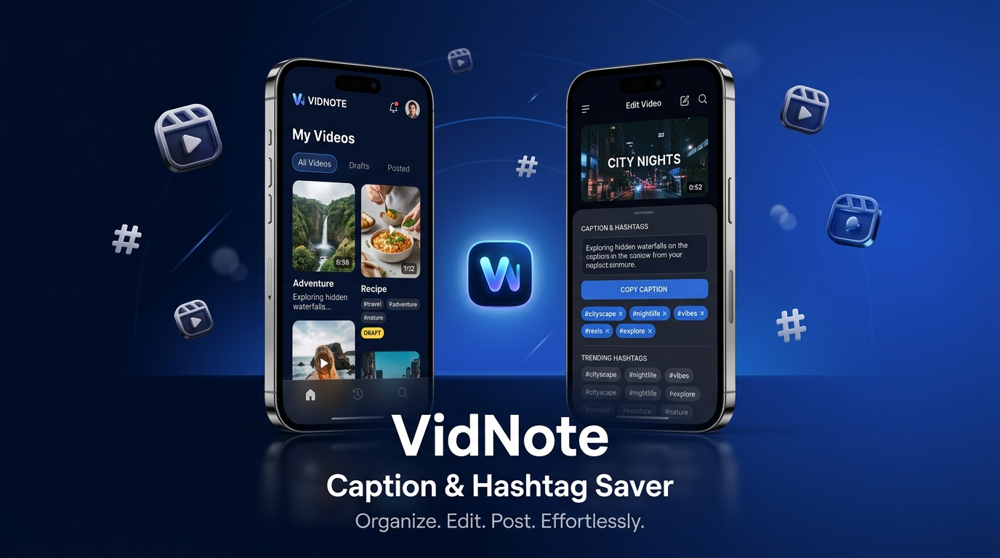

<div align="center">

# 🎬 VidNote: Caption & Hashtag Saver

> **Offline-First Video Draft Vault, Smart Caption Formatter & Hashtag Organizer for Creators**

[](https://react.dev/)
[](https://tailwindcss.com/)
[](https://dexie.org/)
[](https://nodejs.org/)
[](https://www.mongodb.com/)
[](https://capacitorjs.com/)
[](https://vite-pwa-org.netlify.app/)

<br />

<p align="center">
  
</p>

</div>

---

## 📖 Overview

**VidNote** is an offline-first mobile web application and cross-platform mobile app built specifically for content creators (Instagram Reels, TikTok, YouTube Shorts, and Travel Vloggers). It solves the creator workflow bottleneck: drafting video ideas, capturing automatic video thumbnails, crafting clean captions, and bundling high-converting hashtags—**completely functional offline with zero internet connection**, backed by automatic background cloud sync and zero-effort Over-The-Air (OTA) updates.

---

## 🌟 Key Features

### 1. 🔒 100% Offline Video Blob & Thumbnail Vault
- Powered by **IndexedDB (`Dexie.js`)** acting as the single source of truth on the client device.
- Stores genuine video binary `Blob` objects, offscreen canvas-generated 1.0s video frame Base64 thumbnails, and metadata locally.
- Zero latency, zero buffering delays, and zero dependence on cell service or Wi-Fi while shooting content in the field.

### 2. 📋 One-Click Unified Caption & Hashtag Copy Block
- One tap copies both your polished caption and hashtag cluster simultaneously, pre-formatted with clean spacing for Instagram, TikTok, and YouTube descriptions.
- Built-in **"✨ Format Spacing"** engine that eliminates awkward paragraph breaks and platform formatting glitches.

### 3. ⚡ Quick Hashtag Presets & Post Status Tracker
- Instant insertion of high-converting preset hashtag clusters sorted by niche (`#reels`, `#trending`, `#aesthetic`, `#foodie`, `#travel`).
- Track publishing lifecycle with one-tap status toggles between **`Draft`** and **`Posted ✅`**.
- Integrated creator analytics dashboard calculating publishing completion rate and top 5 most utilized hashtags.

### 4. 🎥 Full-Screen Custom Video Player with Interactive Pills
- Immersive mobile player streaming video binary Blobs directly from device storage.
- Custom gesture/touch-friendly scrubber bar, rewind 10s, fast forward 10s, mute toggle, and full-screen controls.
- Bottom drawer modal featuring interactive hashtag pills: tap any individual pill to copy that specific hashtag, or tap **"Copy & Mark as Posted ✅"** to trigger celebratory confetti and clipboard copy.

### 5. 🚀 Instant Over-The-Air (OTA) Updates & Cloud Sync
- **Service Worker (`vite-plugin-pwa`)**: Configured with `autoUpdate` and Workbox caching for 100% offline launch and background cache invalidation.
- **Live Over-The-Air (OTA) updates**: Any push to GitHub and Vercel triggers instant client updates inside installed APKs via `UpdatePrompt` toast notifications without requiring the user to download an updated APK.
- **Silent Background Cloud Sync**: Auto-detects network connectivity (`navigator.onLine`) and syncs metadata to Node.js/MongoDB with resilient offline fallbacks.

---

## 📂 Project Folder Structure

```
VidNote/
├── assets/
│   └── banner.png                     # High-resolution showcase banner
├── client/
│   ├── android/                       # Capacitor Android native project
│   ├── public/
│   │   ├── favicon.svg                # Scalable vector favicon
│   │   ├── icons.svg                  # App icons
│   │   └── manifest.json              # Web app manifest
│   ├── src/
│   │   ├── components/
│   │   │   ├── BottomNav.jsx          # Mobile tab bar navigation
│   │   │   ├── CategoryChips.jsx      # Filter category pills
│   │   │   ├── EmptyState.jsx         # Custom 3D vault empty state
│   │   │   ├── Header.jsx             # Top bar with sync and search
│   │   │   ├── IdeasTab.jsx           # Reusable hashtag bundle vault
│   │   │   ├── ProfileModal.jsx       # Creator profile & storage modal
│   │   │   ├── SettingsTab.jsx        # Data management, demo loader & backup
│   │   │   ├── StatsTab.jsx           # Creator publishing analytics
│   │   │   ├── UpdatePrompt.jsx       # PWA / OTA live update listener
│   │   │   ├── VideoCard.jsx          # 2-column video card component
│   │   │   ├── VideoEditorModal.jsx   # Add/Edit draft video modal
│   │   │   └── VideoPlayerModal.jsx   # Fullscreen player with caption sheet
│   │   ├── services/
│   │   │   ├── db.js                  # Dexie.js IndexedDB schema
│   │   │   ├── sampleData.js          # Demo generator & starter videos
│   │   │   └── syncService.js         # REST background sync client
│   │   ├── App.jsx                    # Root view controller & hot toaster
│   │   ├── main.jsx                   # Entry point
│   │   └── index.css                  # Tailwind styles and custom scrollbars
│   ├── .env.example                   # Client environment variable template
│   ├── capacitor.config.json          # Capacitor mobile runtime & OTA config
│   ├── package.json                   # Client scripts & dependencies
│   ├── vercel.json                    # Vercel SPA routing & SW cache headers
│   └── vite.config.js                 # Vite + vite-plugin-pwa configuration
├── server/
│   ├── models/
│   │   └── Video.js                   # Mongoose schema for videos
│   ├── .env.example                   # Server environment template
│   ├── package.json                   # Express & Mongoose dependencies
│   └── server.js                      # Express API, CORS rules & MongoDB sync
├── .gitignore                         # Strict production gitignore
├── capacitor.config.json              # Root Capacitor configuration
├── LICENSE                            # MIT License
└── README.md                          # Documentation
```

---

## 🛠️ Step-by-Step Setup Guide

### 1. Running Locally

#### Prerequisites
- **Node.js**: v18.0.0 or higher
- **npm**: v9.0.0 or higher
- **MongoDB** *(Optional)*: Local MongoDB instance or free MongoDB Atlas cluster (VidNote runs in standalone offline mode if MongoDB is absent)

#### Backend Setup
```bash
# Navigate to backend directory
cd server

# Install dependencies
npm install

# Copy environment variables template
cp .env.example .env

# Start backend server in development mode
npm run dev
# Server runs on http://localhost:5000
```

#### Frontend Setup
```bash
# Navigate to frontend directory in another terminal
cd client

# Install dependencies
npm install

# Copy environment variables template
cp .env.example .env

# Start Vite React development server
npm run dev
# App runs on http://localhost:5173
```

---

### 2. Deploying to Cloud (Render & Vercel)

#### Backend Deployment (Render)
1. Push your repository to **GitHub**.
2. Go to [Render Dashboard](https://dashboard.render.com/) and click **New > Web Service**.
3. Connect your GitHub repository.
4. Set the following configuration:
   - **Root Directory**: `server`
   - **Build Command**: `npm install`
   - **Start Command**: `node server.js`
   - **Environment Variables**:
     - `PORT`: `5000`
     - `MONGO_URI`: `mongodb+srv://<username>:<password>@cluster.mongodb.net/vidnote?retryWrites=true&w=majority`
     - `NODE_ENV`: `production`
5. Click **Create Web Service**. Your API will be live at `https://your-service.onrender.com`.

#### Frontend Deployment (Vercel)
1. Go to [Vercel Dashboard](https://vercel.com/) and click **Add New > Project**.
2. Select your repository.
3. Set the following configuration:
   - **Framework Preset**: `Vite`
   - **Root Directory**: `client`
   - **Build Command**: `npm run build`
   - **Output Directory**: `dist`
   - **Environment Variables**:
     - `VITE_API_URL`: `https://your-service.onrender.com/api`
4. Click **Deploy**.
5. Vercel automatically applies `client/vercel.json` for SPA rewrites and proper `no-cache` headers for `sw.js` and `manifest.webmanifest`.

---

### 3. Compiling Android APK with Capacitor & Pushing Live Updates

#### Build Native Android App
```bash
# 1. Build optimized client bundle
cd client
npm run build

# 2. Add Android platform (if first time)
npx cap add android

# 3. Synchronize web assets with native project
npx cap sync android

# 4. Open in Android Studio to build APK or run on device/emulator
npx cap open android
```

#### Enabling Instant Live Over-The-Air (OTA) Updates
To push updates directly to your users' devices over the air without recompiling an APK:

1. Open `client/capacitor.config.json`.
2. Add the `url` property inside `server` pointing to your deployed Vercel domain:
   ```json
   {
     "appId": "com.vidnote.app",
     "appName": "VidNote",
     "webDir": "dist",
     "bundledWebRuntime": false,
     "server": {
       "androidScheme": "https",
       "cleartext": true,
       "url": "https://vidnote.vercel.app"
     }
   }
   ```
3. Whenever you push changes to GitHub:
   ```bash
   git add .
   git commit -m "feat: Add new creator features"
   git push origin main
   ```
4. Vercel automatically rebuilds and publishes the update.
5. The `UpdatePrompt` component detects the new deployment when the device is online and presents:
   > **"✨ New update available! Refreshing..."**
   and silently reloads with the latest changes while preserving local IndexedDB video blobs!

---

## 📄 License

This project is licensed under the [MIT License](LICENSE).
